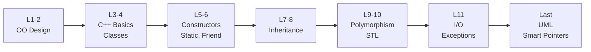
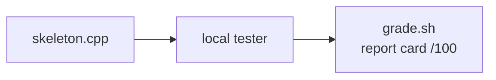

# IIIT-B C++ Course 2026 · EGC 211P

   

My work for the IIIT-B C++ / OOP course: labs, notes, past papers, and a midsem prep kit with auto-graders.

## Syllabus



## Labs

| Lab | Build | Concepts |
|:-:|---|---|
| 1 | `TomStory` | first class, members |
| 2 | Cistagram | class design, skeleton completion |
| 3 | Sort · Stock · Overloading | function overloading, sorting |
| 4 | Point · Book · Cistagram+ | copy constructor, header/source split, no STL |
| 5 | Sales_data · Screen/Window_mgr | constructors, `friend` classes |
| 6 | Quote · Cistagram+ | inheritance, `virtual`, overriding |
| 7 | E-Commerce Cart | abstract class, operator overloading, exceptions, file I/O |

## Midsem prep



| Practice | What it drills |
|---|---|
| 2025 Lab Quiz | e-commerce cart from a UML diagram |
| 2025 GIE | JOIN operators: nested-loop and hash join |
| 2026 Lab Quiz | UPI wallet: Logger, custom exceptions, menu wiring |
| Mock 1 | 2025 midsem rebuilt: conference paper review |
| Mock 2 | order-matching engine: price-time priority, `shared_ptr` |

`Cpp_Midsem_Cheatsheet.pdf` is the 2-page exam sheet. `GRADING.md` says how to run the graders.

## Layout

```text
├── Lecture Slides/     L1 → L11 + UML
├── LabPrograms/        Lab-1 … Lab-7
├── Notes/              OOP notes + study plan
├── 2026 PYQs/          lab quiz + theory quiz
└── Midsem Practice/    mocks, graders, references, cheatsheet
```
